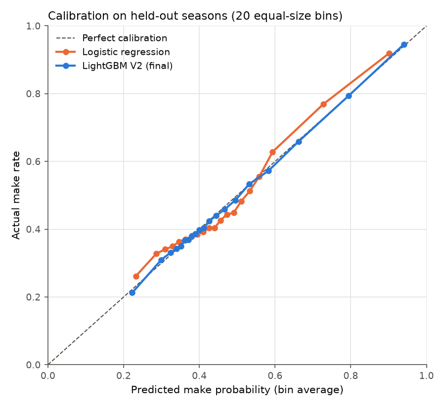
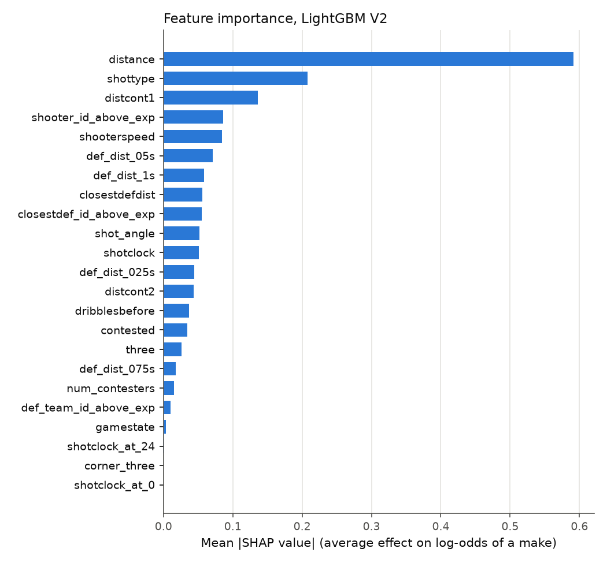
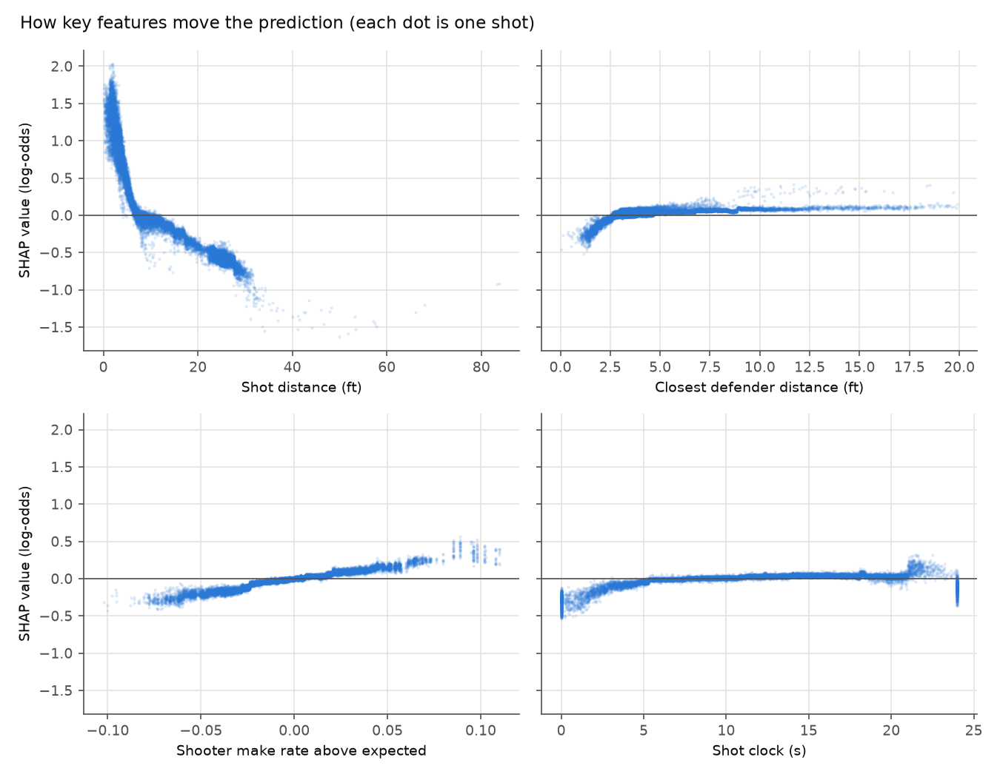

# NBA Shot Make Probability Model

Predicts the probability that an NBA shot goes in, using features derived from player-tracking data: shot location and type, defender distance and closeout, shot clock, and who is shooting and defending.

Built as a project for an NBA analyst internship application. There is a more extensive write-up which covers the full reasoning, but this page is the short version.

## Results

Each model was trained on one season and scored on the other (then swapped), since the goal was predicting a season the model had never seen. Scores are log-loss; lower is better.

| Model | Log-loss |
|---|---|
| Constant baseline (league make rate for every shot) | 0.6896 |
| Logistic regression | 0.6386 |
| LightGBM, shot and defense features | 0.6265 |
| LightGBM + raw court coordinates | 0.6266 |
| LightGBM + plain player make rates | 0.6267 |
| **LightGBM + player make rate above expected (final)** | **0.6254** |

The final model is also well calibrated: across 20 bins, predicted and actual make rates agree within about 1 percentage point.



## What drives the predictions



Shot distance dominates, then shot type and how closely the shot was contested. Shooter skill and shooter speed come next.



- **Distance:** a large boost at the rim, then a steady decline. This curve is why a tree model beats logistic regression.
- **Closest defender:** only hurts when the defender is within about 2.5 ft.
- **Shooter skill:** better-than-expected shooters get a steady boost.
- **Shot clock:** a penalty in the final ~5 seconds.

## Approach

1. **Cleaning.** Parsed defender approach distances, filled missing contest distances, flagged shot-clock edge cases (end-of-quarter heaves at 0, putbacks at 24), and added shot angle.
2. **Validation.** Leave-one-season-out, so every score comes from a season the model never trained on.
3. **Baselines.** A constant prediction, then logistic regression to measure how much a simple model captures.
4. **LightGBM.** Gradient boosted trees with early stopping and leaf-size limits to control overfitting.
5. **Player features.** Plain player make rates added nothing, because they mostly reflect shot selection (centers take more dunks). Instead, each shooter, closest defender, and defensive team gets a *make rate above expected*: their average of (made − expected), where expected is the league rate for that shot type and distance. Values are smoothed toward average for small samples and computed out-of-fold to avoid leakage.
6. **Interpretation.** Calibration curve plus SHAP values, using LightGBM's built-in TreeSHAP.

## Lessons from the project

- **Match data prep to the model.** Filling "no contester" with 30 ft worked for trees, but in logistic regression it made being contested look like 20x better odds. Zero-filling with a contested flag fixed it.
- **More features don't always help.** Raw coordinates added nothing beyond distance and angle.
- **Identity alone isn't skill.** Player IDs only became useful once adjusted for shot difficulty.

## Repo contents

| File | What it is |
|---|---|
| `project_code.py` | Full pipeline: loading, cleaning, validation, all models, figures, final predictions |
| `project_writeup.pdf` | Write-up with methods, results, limitations, and next steps |
| `figures/` | Calibration and SHAP plots |

## Running it

The data came from the application project and isn't included, so the script won't run as-is. With the original `training.csv.gz`, `testing.csv.gz`, and `submission.csv` template in the repo root:

```
pip install polars pandas numpy scikit-learn lightgbm matplotlib pyarrow
python project_code.py
```

A full run takes about a minute. On macOS, LightGBM needs OpenMP (`brew install libomp`).

## Tools

Python · polars · scikit-learn · LightGBM · matplotlib
